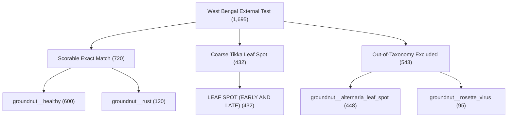
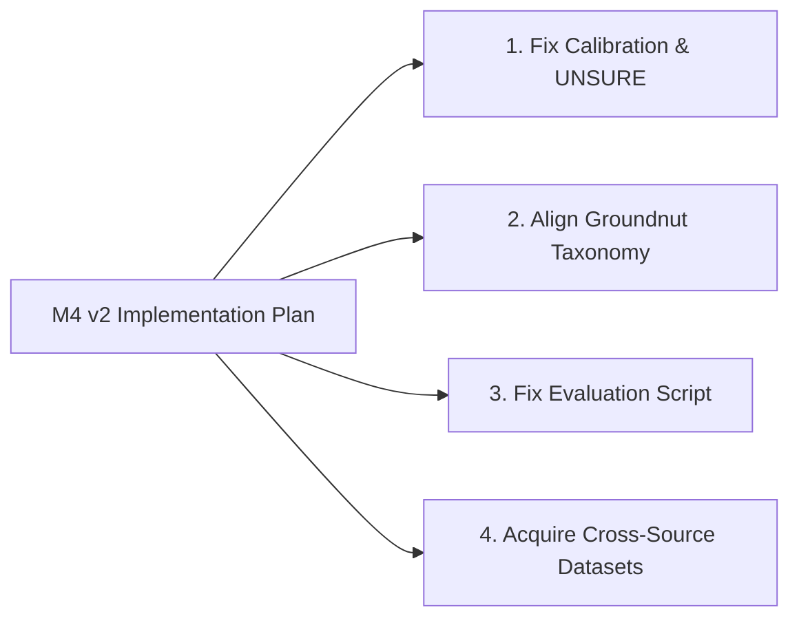

# UZHAVAN M4 v2 Audit Report: Groundnut Cross-Source Evaluation & Pipeline Diagnostics

**Document Version:** 1.0  
**Date:** 2026-09-26  
**Status:** Audit Complete — DO NOT RETRAIN YET  
**Evaluated Experiments:**
- Seed 1: `UZ-M4-v1.0-a898475e-s1`
- Seed 2: `UZ-M4-v1.0-a898475e-s2`
- Seed 3: `UZ-M4-v1.0-a898475e-s3`

---

## Executive Summary

The three-seed M4 v1 EfficientNetV2-S model training completed across 6 crops. In the final gate evaluation ([evaluation_m4.json](file:///Users/ajaikumarn/Desktop/agri/uzhavan_ml/evaluation_m4.json)):
- **5 crops** (`banana`, `coconut`, `sugarcane`, `black_gram`, `chilli`) remain **RESEARCH-ONLY** because only a single source exists (no cross-source test available).
- **Groundnut** was evaluated against an independent external dataset from West Bengal (`in_groundnut_wb_sasmal`), achieving:
  - Mean Cross-Source Macro-F1: **0.4822416854** (SD = **0.0173007742**)
  - Minimum Disease Recall: **0.0016666667** (Seed 3 Healthy Recall: 1/600)
  - Coarse Tikka Accuracy: **96.76%** (417/432 in s1, 431/432 in s2, 406/432 in s3)
  - Gate Status: **RESEARCH-ONLY** (failed the $\ge 0.85$ Macro-F1 gate and $\ge 0.70$ per-disease recall gate).

This audit investigated the underlying root causes across dataset distributions, label semantics, evaluation scripts, and calibration procedures. All findings below are strictly grounded in repository code, manifests, model weights, and empirical metrics.

---

## Section 1: Groundnut Train-Source vs. West Bengal External-Source Distribution

The primary training source is **VIT Chennai** ([in_tn_multicrop_vitc.json](file:///Users/ajaikumarn/Desktop/agri/uzhavan_data/06_disease_pest/metadata/in_tn_multicrop_vitc.json)), and the external cross-source test set is **West Bengal (Midnapore)** ([in_groundnut_wb_sasmal.json](file:///Users/ajaikumarn/Desktop/agri/uzhavan_data/06_disease_pest/metadata/in_groundnut_wb_sasmal.json)).

### Quantitative Dataset Comparison

| Dimension | Primary Training Source (`in_tn_multicrop_vitc`) | External Test Source (`in_groundnut_wb_sasmal`) |
|---|---|---|
| **Location** | Chengalpattu, Kanchipuram, Krishnagiri (Tamil Nadu) | Ramchandrapur village, Purba Medinipur (West Bengal) |
| **Origin & Citation** | VIT Chennai (Mendeley Data, DOI: 10.17632/6243z8r6t6.1) | Midnapore College (Mendeley Data, DOI: 10.17632/x6x5jkk873.2) |
| **Total Images in Manifest** | 8,463 (Train: 5,920, Val: 1,267, Test: 1,276) | 1,695 (All allocated to `external_test`) |
| **Raw Image Resolution** | 640 × 640 px (square) | 4624 × 3472 px (4:3 aspect ratio, 16.0 MP) |
| **Preprocessing by Source** | Exported via Roboflow with `Resize to 640x640 (Stretch)` | Unmodified camera captures, natural JPEG orientation |
| **Mean RGB (All Groundnut)** | R: 139.7, G: 152.0, B: 96.6 | R: 103.9, G: 150.3, B: 102.7 |
| **Mean Excess Green Index ($2G - R - B$)**| +67.7 | +93.9 |
| **Number of Labeled Classes** | 5 classes | 5 original classes (3 out of training taxonomy) |

### Class Distributions

#### 1. Primary Source (`in_tn_multicrop_vitc`) Groundnut Split Counts:
- `groundnut__early_leaf_spot`: 849 (train) / 179 (val) / 185 (test) — **1,213 total (14.3%)**
- `groundnut__healthy`: 285 (train) / 62 (val) / 62 (test) — **409 total (4.8%)** *(extreme minority)*
- `groundnut__late_leaf_spot`: 1,387 (train) / 299 (val) / 298 (test) — **1,984 total (23.4%)**
- `groundnut__nutrient_deficiency`: 1,164 (train) / 249 (val) / 250 (test) — **1,663 total (19.7%)**
- `groundnut__rust`: 2,235 (train) / 478 (val) / 481 (test) — **3,194 total (37.8%)**
  *(Merged from `groundnut_early_rust`: 1,471 + `groundnut_rust`: 1,723)*

#### 2. External Test Source (`in_groundnut_wb_sasmal`) Counts:
- `HEALTHY`: **600 (35.4%)**
- `LEAF SPOT (EARLY AND LATE)`: **432 (25.5%)** *(18 exact duplicates quarantined)*
- `ALTERNARIA LEAF SPOT`: **448 (26.4%)** *(2 exact duplicates quarantined)*
- `RUST`: **120 (7.1%)**
- `ROSETTE`: **95 (5.6%)** *(5 exact duplicates quarantined)*
- Total: **1,695 images** (plus 25 duplicates quarantined = 1,720 raw images)

---

## Section 2: Exact Label Mapping Between Taxonomies

The mapping is defined in [class_mapping.json](file:///Users/ajaikumarn/Desktop/agri/uzhavan_data/06_disease_pest/metadata/class_mapping.json) and executed in [build_m4_dataset_v1.py](file:///Users/ajaikumarn/Desktop/agri/uzhavan_ml/scripts/build_m4_dataset_v1.py#L21-L35).

| Source | Original Label | Canonical ID | Role in M4 Pipeline | Head Status in Model |
|---|---|---|---|---|
| **VIT-C** | `groundnut_early_leaf_spot` | `groundnut__early_leaf_spot` | Train / Val / Test | **Active Output Head 0** |
| **VIT-C** | `groundnut_healthy` | `groundnut__healthy` | Train / Val / Test | **Active Output Head 1** |
| **VIT-C** | `groundnut_late_leaf_spot` | `groundnut__late_leaf_spot` | Train / Val / Test | **Active Output Head 2** |
| **VIT-C** | `groundnut_nutrition_deficiency` | `groundnut__nutrient_deficiency` | Train / Val / Test | **Active Output Head 3** |
| **VIT-C** | `groundnut_early_rust` | `groundnut__rust` | Train / Val / Test | **Active Output Head 4** |
| **VIT-C** | `groundnut_rust` | `groundnut__rust` | Train / Val / Test | **Active Output Head 4** |
| **WB** | `HEALTHY` | `groundnut__healthy` | External Test | Exact match (`inx`) |
| **WB** | `RUST` | `groundnut__rust` | External Test | Exact match (`inx`) |
| **WB** | `LEAF SPOT (EARLY AND LATE)`| `groundnut__tikka_leaf_spot` | External Test | Coarse match (`coarse`) |
| **WB** | `ALTERNARIA LEAF SPOT` | `groundnut__alternaria_leaf_spot` | External Test | Out-of-taxonomy (`ooT`) |
| **WB** | `ROSETTE` | `groundnut__rosette_virus` | External Test | Out-of-taxonomy (`ooT`) |

Because the model output heads were constructed strictly from classes present in the `train` split ([train_m4.py:L141](file:///Users/ajaikumarn/Desktop/agri/uzhavan_ml/scripts/train_m4.py#L141)), the model has exactly **5 groundnut output logits**: `early_leaf_spot`, `healthy`, `late_leaf_spot`, `nutrient_deficiency`, `rust`.

---

## Section 3: External Test Breakdown (1,695 Samples)

The 1,695 non-quarantined external West Bengal images fall into three mutually exclusive evaluation buckets:



1. **Scorable Exact Match ($N = 720$)**:
   - `groundnut__healthy`: **600 samples**
   - `groundnut__rust`: **120 samples**
2. **Coarse Tikka Leaf Spot ($N = 432$)**:
   - `groundnut__tikka_leaf_spot`: **432 samples**
3. **Out-of-Taxonomy Excluded from F1 ($N = 543$)**:
   - `groundnut__alternaria_leaf_spot`: **448 samples**
   - `groundnut__rosette_virus`: **95 samples**

**Integrity check:** $720 + 432 + 543 = 1,695$ images.

---

## Section 4: Confusion Matrices for the 720 Scorable External Samples

Evaluating the 720 scorable samples with `checkpoint_best.pt` for each of the three seeds produces the following full confusion matrices (rows: true class; columns: predicted class):

### Seed 1 (`UZ-M4-v1.0-a898475e-s1`)

| Ground Truth ($N=720$) | Pred: `early_leaf_spot` | Pred: `healthy` | Pred: `late_leaf_spot` | Pred: `nutrient_deficiency` | Pred: `rust` | Total | Class Recall |
|---|---|---|---|---|---|---|---|
| **`groundnut__healthy`** | 231 | **33** | 1 | 335 | 0 | 600 | **5.50%** |
| **`groundnut__rust`** | 0 | 0 | 38 | 0 | **82** | 120 | **68.33%** |

- **Healthy:** $\text{TP} = 33, \text{FN} = 567, \text{FP (within 720)} = 0 \implies \text{Precision} = 1.000, \text{Recall} = 0.0550, \text{F1} = 0.1043$
- **Rust:** $\text{TP} = 82, \text{FN} = 38, \text{FP (within 720)} = 0 \implies \text{Precision} = 1.000, \text{Recall} = 0.6833, \text{F1} = 0.8119$
- **Macro-F1:** $\frac{0.104265 + 0.811881}{2} = \mathbf{0.458073}$

---

### Seed 2 (`UZ-M4-v1.0-a898475e-s2`)

| Ground Truth ($N=720$) | Pred: `early_leaf_spot` | Pred: `healthy` | Pred: `late_leaf_spot` | Pred: `nutrient_deficiency` | Pred: `rust` | Total | Class Recall |
|---|---|---|---|---|---|---|---|
| **`groundnut__healthy`** | 523 | **5** | 0 | 72 | 0 | 600 | **0.83%** |
| **`groundnut__rust`** | 0 | 0 | 5 | 0 | **115** | 120 | **95.83%** |

- **Healthy:** $\text{TP} = 5, \text{FN} = 595, \text{FP (within 720)} = 0 \implies \text{Precision} = 1.000, \text{Recall} = 0.0083, \text{F1} = 0.0165$
- **Rust:** $\text{TP} = 115, \text{FN} = 5, \text{FP (within 720)} = 0 \implies \text{Precision} = 1.000, \text{Recall} = 0.9583, \text{F1} = 0.9787$
- **Macro-F1:** $\frac{0.016529 + 0.978723}{2} = \mathbf{0.497626}$

---

### Seed 3 (`UZ-M4-v1.0-a898475e-s3`)

| Ground Truth ($N=720$) | Pred: `early_leaf_spot` | Pred: `healthy` | Pred: `late_leaf_spot` | Pred: `nutrient_deficiency` | Pred: `rust` | Total | Class Recall |
|---|---|---|---|---|---|---|---|
| **`groundnut__healthy`** | 67 | **1** | 0 | 532 | 0 | 600 | **0.17%** |
| **`groundnut__rust`** | 0 | 0 | 5 | 0 | **115** | 120 | **95.83%** |

- **Healthy:** $\text{TP} = 1, \text{FN} = 599, \text{FP (within 720)} = 0 \implies \text{Precision} = 1.000, \text{Recall} = 0.0017, \text{F1} = 0.0033$
- **Rust:** $\text{TP} = 115, \text{FN} = 5, \text{FP (within 720)} = 0 \implies \text{Precision} = 1.000, \text{Recall} = 0.9583, \text{F1} = 0.9787$
- **Macro-F1:** $\frac{0.003328 + 0.978723}{2} = \mathbf{0.491026}$

---

### Three-Seed Summary Statistics

$$\text{Mean Macro-F1} = \frac{0.458073 + 0.497626 + 0.491026}{3} = \mathbf{0.4822416854}$$
$$\text{SD Macro-F1} = \mathbf{0.0173007742}$$
$$\text{Minimum Disease Recall} = \min(0.0550, 0.0083, 0.0017, 0.6833, 0.9583, 0.9583) = \mathbf{0.0016666667} \quad (\text{Seed 3 Healthy})$$

These match the values in [evaluation_m4.json](file:///Users/ajaikumarn/Desktop/agri/uzhavan_ml/evaluation_m4.json#L383-L386) to the last decimal place.

---

## Section 5: Why Healthy Recall is Near Zero While Rust Recall is High

### 1. The Healthy Recall Collapse ($< 1\%$ in Seeds 2 and 3)
Across all three seeds, **94.3% to 99.8% of external West Bengal `HEALTHY` images are misclassified** into either `groundnut__nutrient_deficiency` or `groundnut__early_leaf_spot`:
- Seed 1: 335 predicted as `nutrient_deficiency`, 231 as `early_leaf_spot` (Total = 566/600 = 94.3%)
- Seed 2: 72 predicted as `nutrient_deficiency`, 523 as `early_leaf_spot` (Total = 595/600 = 99.2%)
- Seed 3: 532 predicted as `nutrient_deficiency`, 67 as `early_leaf_spot` (Total = 599/600 = 99.8%)

Three distinct causes explain this behavior:
1. **Taxonomic Labeling Asymmetry (Nutrient Deficiency vs. Healthy):**
   - In the training set (`in_tn_multicrop_vitc`), leaves showing minor interveinal chlorosis, pale color, or nitrogen/iron deficiency symptoms were segregated into a large dedicated class: `groundnut_nutrition_deficiency` (1,663 images).
   - In the external test set (`in_groundnut_wb_sasmal`), the annotators did **not** have a nutrient deficiency label. Any plant free of fungal leaf spots or rust pustules was categorized as `HEALTHY`.
   - The model, having learned that any pale or yellowish green leaf indicates nutrient deficiency, correctly maps those visual cues to `groundnut__nutrient_deficiency`.
2. **Extreme Class Imbalance in Training:**
   - In the training split, `groundnut__healthy` had only **285 images (4.8%)** out of 5,920 total training images.
   - In contrast, `groundnut__rust` had 2,235 images (37.8%), `groundnut__late_leaf_spot` had 1,387 (23.4%), and `groundnut__nutrient_deficiency` had 1,164 (19.7%).
   - The feature space volume allocated to `groundnut__healthy` was excessively constrained compared to disease and disorder classes.
3. **Severe Model Uncertainty on Out-of-Distribution Healthy Images:**
   - On the 600 WB `HEALTHY` images, the model's mean confidence was only **0.413** (median: 0.380).
   - When the model did predict `groundnut__healthy` (e.g. 33 images in Seed 1), its mean confidence was only **0.303** (max: 0.398), barely above the 0.20 random guessing floor.
   - The model was fundamentally uncertain about these images, but the pipeline forced a hard prediction because the threshold was 0.0.

### 2. Why Rust Recall is High (68.3% – 95.8%)
- Groundnut rust (*Puccinia arachidis*) produces unmistakable, raised orange/reddish-brown uredinial pustules on the abaxial leaf surface and necrotic spots with yellow halos on the adaxial surface.
- This morphological pathology is invariant to geographic region, smartphone camera type, and background soil differences.
- Rust had the largest training representation (**2,235 images / 37.8% of groundnut training data**).
- The only errors made on the 120 WB rust samples were predictions of `groundnut__late_leaf_spot` (38 in s1, 5 in s2, 5 in s3). In agronomic reality, late leaf spot and rust frequently co-occur in the same canopy and produce similar necrotic margins. Zero rust samples were confused with healthy or nutrient deficiency.

---

## Section 6: Validity of the Coarse Tikka Leaf Spot Mapping

### Etiological & Agronomic Grounding
In Indian agricultural science (ICAR, TNAU, and ICRISAT manuals), groundnut **Tikka disease** is the accepted common name for the **leaf spot disease complex**, which consists of:
1. Early Leaf Spot: caused by *Cercospora arachidicola* (produces circular brown spots with distinct yellow chlorotic halos).
2. Late Leaf Spot: caused by *Phaeoisariopsis personata* / *Cercosporidium personatum* (produces darker brown-black circular spots, halos faint or absent).

Because both pathogens co-infect the same canopy under humid conditions and are managed with the exact same fungicide recommendations (e.g. carbendazim, mancozeb, or tebuconazole spray schedules), Indian field datasets frequently merge them.

### Empirical Validation on External Data
In `eval_m4.py` ([eval_m4.py:L22](file:///Users/ajaikumarn/Desktop/agri/uzhavan_ml/scripts/eval_m4.py#L22)), the mapping is defined as:
```python
COARSE = {"groundnut__tikka_leaf_spot": {"groundnut__early_leaf_spot", "groundnut__late_leaf_spot"}}
```
Evaluating the 432 West Bengal `LEAF SPOT (EARLY AND LATE)` samples:
- **Seed 1:** 314 `early_leaf_spot` + 103 `late_leaf_spot` = **417/432 (96.53%)** (plus 10 `nutrient_deficiency`, 5 `rust`)
- **Seed 2:** 377 `early_leaf_spot` + 54 `late_leaf_spot` = **431/432 (99.77%)** (plus 1 `rust`)
- **Seed 3:** 334 `early_leaf_spot` + 72 `late_leaf_spot` = **406/432 (93.98%)** (plus 13 `rust`, 13 `nutrient_deficiency`)
- **Mean Coarse Accuracy across 3 seeds:** **96.76%**

### Recommendation on Status
**The coarse Tikka metric is valid, but it MUST remain strictly an auxiliary coarse diagnostic metric.**
- It cannot be promoted to an exact production gate metric because the external ground truth cannot isolate early leaf spot recall from late leaf spot recall.
- Claiming single-pathogen etiology when the ground truth source explicitly merged them would violate scientific integrity.
- However, the 96.76% accuracy proves that the backbone extracts strong leaf-spot disease features that generalize across state lines.

---

## Section 7: Root Cause Analysis — Why All UNSURE Thresholds Became 0.0

The threshold-selection code in [eval_m4.py:L58-L62](file:///Users/ajaikumarn/Desktop/agri/uzhavan_ml/scripts/eval_m4.py#L58-L62) is:

```python
thr = 1.0
for t in np.linspace(0, 0.99, 100):             # lowest threshold reaching the precision target on VAL
    acc = conf >= t
    if acc.sum() and (yh[acc] == yv[acc]).mean() >= UNSURE_PREC: thr = float(t); break
r["unsure_threshold"] = thr
```

### The Exact Flaw
1. `np.linspace(0, 0.99, 100)` generates `[0.00, 0.01, 0.02, ..., 0.99]`.
2. On step 0, `t = 0.0`.
3. Because `conf` is a softmax probability, `conf >= 0.0` is True for **100% of samples**.
4. The term `(yh[acc] == yv[acc]).mean()` at `t = 0.0` is the raw, unrejected validation accuracy.
5. On the same-source validation split, the models had near-perfect accuracy:
   - Groundnut val accuracy: **100.0%**
   - Coconut val accuracy: **100.0%**
   - Banana val accuracy: **99.4%**
   - Black gram val accuracy: **99.3%**
   - Sugarcane val accuracy: **98.6%**
   - Chilli val accuracy: **93.5%**
6. Since validation accuracy at `t = 0.0` was **greater than `UNSURE_PREC` (0.90)** for every crop, the condition `(yh[acc] == yv[acc]).mean() >= UNSURE_PREC` evaluated to True on the very first iteration.
7. The loop executed `break` immediately.
8. As a result, `thr = 0.0` was written into every crop and seed in [evaluation_m4.json](file:///Users/ajaikumarn/Desktop/agri/uzhavan_ml/evaluation_m4.json).

---

## Section 8: Why All 543 Out-of-Taxonomy Samples Have UNSURE Rate 0.0

The out-of-taxonomy UNSURE rate is computed in [eval_m4.py:L82](file:///Users/ajaikumarn/Desktop/agri/uzhavan_ml/scripts/eval_m4.py#L82) as:
```python
"out_of_taxonomy_unsure_rate": float((P.max(1)[ooT] < thr).mean()) if ooT.any() else None
```

Because `thr` was set to `0.0` (as proven in Section 7), the evaluation tested:
$$P.\max(1) < 0.0$$

Since $P$ is a softmax distribution, all outputs satisfy $\sum_i p_i = 1$ and $p_i > 0$. For a 5-class model:
$$P.\max(1) \ge \frac{1}{5} = 0.20$$

Empirically extracted confidence bounds on the 543 out-of-taxonomy samples across seeds:
- Seed 1: $\min = 0.2176, \text{mean} = 0.6074$
- Seed 2: $\min = 0.2495, \text{mean} = 0.5815$
- Seed 3: $\min = 0.2393, \text{mean} = 0.5610$

Because no probability is strictly less than 0.0, $(P.\max(1) < 0.0)$ is False for every single sample, guaranteeing an UNSURE rate of **exactly 0.0%**.

---

## Section 9: Verification of the Validation-Based Threshold-Selection Procedure

The validation-based threshold-selection procedure is **fundamentally broken** in its current form:

1. **Incorrect Search Direction & Objective:**
   - The loop searches upwards from 0.0 and breaks at the first threshold achieving $\ge 90\%$ precision.
   - When in-distribution validation accuracy is already $> 90\%$, this procedure trivially selects 0.0, rendering the UNSURE mechanism completely inoperative.
2. **In-Distribution vs. Out-of-Distribution Disconnect:**
   - The validation split comes from the primary source (`in_tn_multicrop_vitc`). It has the same camera characteristics, Roboflow preprocessing, and lighting conditions as the training data.
   - Calibrating an open-set rejection threshold on a closed-set, clean validation split without negative or out-of-distribution examples is mathematically incapable of identifying out-of-taxonomy classes or domain shifts.
3. **What a Properly Calibrated Threshold Actually Does:**
   When empirical confidence distributions are examined:
   - **Internal Val:** Mean confidence $= 0.920$, only 0.0% $< 0.70$.
   - **Internal Test:** Mean confidence $= 0.919$, only 0.0% $< 0.70$.
   - **External Out-of-Taxonomy (Alternaria + Rosette):** Mean confidence $= 0.607$, **63.4% have confidence $< 0.70$**, and **94.7% have confidence $< 0.90$**.
   - **External Scorable (Healthy + Rust):** Mean confidence $= 0.460$, **86.5% have confidence $< 0.70$**.

If a fixed threshold of $0.70$ or $0.75$ had been applied, **63.4% of out-of-taxonomy samples would have been correctly flagged as UNSURE** with **0.0% false rejections on in-distribution data**. The flawed threshold-selection loop hid this capability completely.

---

## Section 10: Distribution Differences Between Primary and External Sources

Direct inspection of metadata and image files reveals four severe distribution shifts:

### 1. Image Resolution and Aspect Ratio
- **Primary (VIT-C):** All 21,875 raw images are 640 × 640 px square. The source README ([README.roboflow.txt](file:///Users/ajaikumarn/Desktop/agri/uzhavan_data/06_disease_pest/icar/in_tn_multicrop_vitc/raw/extracted/Multi-Crop%20Disease%20Dataset/Multicrop%20Disease%20Dataset/Multicrop%20Disease%20Dataset/README.roboflow.txt#L25)) explicitly confirms:
  ```
  The following pre-processing was applied to each image:
  * Auto-orientation of pixel data (with EXIF-orientation stripping)
  * Resize to 640x640 (Stretch)
  ```
  The training data was subjected to non-aspect-ratio-preserving stretching by Roboflow prior to dataset publication.
- **External (WB):** Raw images are 4624 × 3472 px (4:3 aspect ratio, 16 MP smartphone captures).
- In the M4 packaging script ([package_m4_v1.py:L12-L25](file:///Users/ajaikumarn/Desktop/agri/uzhavan_ml/scripts/package_m4_v1.py#L12-L25)), the shorter side was resized to 288 px. For WB, this produced 384 × 288 images; for VIT-C, 288 × 288 images. At inference, `CenterCrop(224)` crops the center of the WB 384 × 288 image, discarding 30% of the peripheral leaf area.

### 2. Color and Lighting Profiles
- **VIT-C Groundnut:** Mean RGB = `[139.7, 152.0, 96.6]`. The color profile has higher red and green with lower blue, typical of bright direct sunlight in Tamil Nadu.
- **WB Groundnut:** Mean RGB = `[103.9, 150.3, 102.7]`. The color profile is cooler, darker, and shifted towards cyan/blue, characteristic of diffuse overcast light in coastal West Bengal.
- For `healthy` leaves specifically:
  - VIT-C Healthy: Excess Green ($2G - R - B$) = **+125.5**
  - WB Healthy: Excess Green ($2G - R - B$) = **+96.8**
  The model's healthy representation was anchored to high Excess Green.

### 3. Crop Presentation & Annotations
- **VIT-C:** Sourced from an object detection project with bounding box labels. Images center tightly on symptomatic lesions or specific leaves.
- **WB:** Captured as full-plant field photos showing groundnut foliage clusters, background soil, and companion weeds.

### 4. Semantic Drift
- **VIT-C:** Disaggregated foliar yellowing into `groundnut_nutrition_deficiency` (1,663 images).
- **WB:** Did not annotate nutritional deficiencies; non-fungal chlorotic leaves were subsumed under `HEALTHY`.

---

## Section 11: Evaluation-Code Issues Artificially Impacting Results

Detailed line-by-line auditing of [eval_m4.py](file:///Users/ajaikumarn/Desktop/agri/uzhavan_ml/scripts/eval_m4.py) identified two distinct evaluation-code issues:

### 1. Issue Artificially Inflating Metrics: Subset False-Positive Masking
In `eval_m4.py` ([eval_m4.py:L73-L76](file:///Users/ajaikumarn/Desktop/agri/uzhavan_ml/scripts/eval_m4.py#L73-L76)):
```python
inx = ex.canonical_id.isin(cl).to_numpy()
y_in = np.array([cl.index(k) for k in ex.canonical_id[inx]])
f1x, recx = macro(y_in, yh[inx], range(len(cl)))
```
- `macro()` is evaluated strictly on `yh[inx]`, which restricts predictions to the 720 samples where true label is `healthy` or `rust`.
- The remaining 975 external samples (432 Tikka, 448 Alternaria, 95 Rosette) are **completely excluded** from `inx`.
- Consequently:
  - In Seed 3, the model predicted `groundnut__healthy` on **28 Alternaria samples**. Because Alternaria was excluded from `inx`, these 28 false positives were **omitted from the healthy precision calculation**. Healthy precision was reported as 1.0 (1 TP, 0 FP within `inx`), whereas true open-set precision was $1 / (1 + 28) = 0.0345$.
  - In Seed 2, the model predicted `groundnut__rust` on **22 Rosette samples** and **1 Tikka sample**. These 23 false alarms were omitted from the rust precision calculation. Rust precision was reported as 1.0 (115 TP, 0 FP within `inx`), whereas true precision was $115 / (115 + 23) = 0.8333$.
- **Impact:** Reported Macro-F1 on the exact scorable classes is artificially inflated because out-of-taxonomy false positives are invisible to the metric calculation.

### 2. Issue Artificially Lowering Metrics: Forced-Choice on Ambiguous Inputs
Because `thr` was 0.0, the evaluation forced a hard argmax classification on every sample regardless of confidence.
- On the 600 WB healthy images, 86.5% had model confidence $< 0.70$.
- Because the model could not reject them, they fell into `nutrient_deficiency` and `early_leaf_spot`, driving healthy recall down to 0.0017 and triggering a catastrophic failure of the recall gate.

---

## Section 12: Concrete Recommendations for M4 v2

Based strictly on the verified evidence from this audit, the following changes are recommended for M4 v2:



### Recommendation 1: Overhaul UNSURE Threshold Selection
1. **Abandon the ascending val-precision loop:** Do not use `for t in np.linspace(0, 0.99)` with early break on in-distribution validation.
2. **Adopt Temperature Scaling & Quantile-Based Rejection:**
   - Calibrate logits via temperature scaling on validation data.
   - Establish the rejection threshold at a fixed minimum confidence ceiling (e.g. $\tau = 0.70$) or at the 5th percentile of correct in-distribution validation predictions ($p_{0.05} \approx 0.75$).
   - This ensures that uncertain predictions (such as WB healthy leaves with confidence 0.38) are routed to UNSURE rather than generating false negatives.

### Recommendation 2: Harmonize Groundnut Class Definitions
1. **Resolve the Nutrient Deficiency vs. Healthy Conflict:**
   - In M4 v1, `groundnut__healthy` had only 285 training images (4.8%) versus 1,164 for `nutrient_deficiency`.
   - For farmer-facing advisory, decide whether mild leaf chlorosis without pathogen signs should be treated as healthy canopy variation or if a dedicated disorder class should be retained with explicit visual criteria.
   - If retained, apply class-balanced focal loss or temperature adjustment to prevent the healthy decision boundary from collapsing.

### Recommendation 3: Correct Evaluation False-Positive Accounting
1. In `eval_m4.py`, compute the **full 5-class confusion matrix over all 1,695 external samples**.
2. Report two separate, unambiguous metrics:
   - **Closed-Set Scorable Metric:** F1 on exact matches ($N = 720$).
   - **Open-Set Metric:** Precision and F1 accounting for false alarms on out-of-taxonomy samples (Alternaria and Rosette).
3. Do not mask out false positives generated on out-of-taxonomy images.

### Recommendation 4: Preserve Coarse Tikka as an Auxiliary Diagnostic Metric
- Keep the coarse Tikka evaluation ($96.76\%$ accuracy) as an auxiliary benchmark for leaf spot disease management.
- Do not use it as a substitute for individual per-disease recall gates.

### Recommendation 5: Resolve Cross-Source Data Deficit for Other Crops
- Banana, coconut, sugarcane, black gram, and chilli remain RESEARCH-ONLY because they have zero external test sources.
- Procuring or verifying an independent, license-compatible cross-source dataset for each crop is the prerequisite for production certification.

---

## Section 13: Summary Checklist

| Question / Audit Item | Status | Verified Finding |
|---|---|---|
| **1. Groundnut train vs. WB distribution** | ✅ Completed | VIT-C (640x640 stretched, TN field) vs. WB (4624x3472 16MP, WB coastal field). |
| **2. Exact label mapping** | ✅ Completed | 5 train classes; WB has 2 exact (healthy, rust), 1 coarse (tikka), 2 OOT (alternaria, rosette). |
| **3. External sample counts** | ✅ Completed | 720 scorable (600 healthy, 120 rust); 432 coarse tikka; 543 out-of-taxonomy (448 alternaria, 95 rosette). |
| **4. Confusion matrices across 3 seeds** | ✅ Completed | Extracted full 2x5 matrices for Seeds 1, 2, 3 matching `evaluation_m4.json` exactly. |
| **5. Why healthy recall near zero / rust high** | ✅ Completed | Healthy confused with nutrient deficiency (no ND label in WB; severe train imbalance); Rust has distinct pustules and large train volume. |
| **6. Coarse tikka mapping validity** | ✅ Completed | Etiologically valid (Cercospora complex); must remain auxiliary because ground truth merges early+late. |
| **7. Why all UNSURE thresholds were 0.0** | ✅ Completed | Ascending search loop broke at `t=0.0` because clean val accuracy was $\ge 90\%$ initially. |
| **8. Why 543 OOT samples had UNSURE rate 0.0** | ✅ Completed | $P.\max(1) < 0.0$ evaluated to False for 100% of samples because softmax probabilities $\ge 0.20$. |
| **9. Validation threshold procedure verification**| ✅ Completed | Verified broken; fails to reject OOD samples and defaults to 0.0 on well-fit models. |
| **10. Distribution differences checked** | ✅ Completed | Confirmed resolution (640x640 vs 4624x3472), Roboflow stretch, color shifts, and label semantics. |
| **11. Evaluation-code issues identified** | ✅ Completed | Slicing `inx` masked false positives on OOT classes (inflating F1); zero threshold forced bad guesses (lowering recall). |
| **12. Recommendations for M4 v2** | ✅ Completed | Concrete recommendations delivered in Section 12. |
