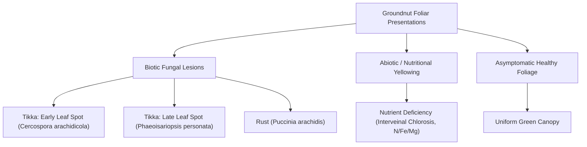
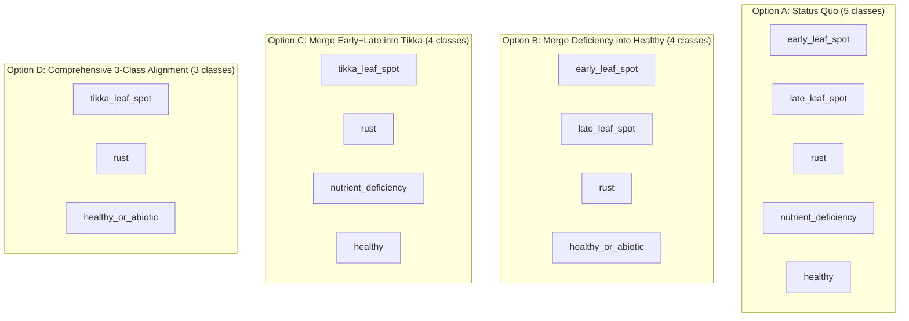

# UZHAVAN M4 v2 Taxonomy Options & Agronomic Grounding

**Document Version:** 1.0  
**Date:** 2026-09-26  
**Status:** Pre-Training Review & Decision Framework  
**Scope:** Groundnut foliar disease, disorder, and canopy health taxonomy

---

## 1. Pathological & Agronomic Ground Truth Definitions

Groundnut (*Arachis hypogaea*) foliar pathologies in South Asian agro-ecosystems (Tamil Nadu, Andhra Pradesh, West Bengal) are characterized by five distinct visual presentations:

### 1.1 `groundnut__healthy`
- **Biological Definition:** Fully expanded, asymptomatic groundnut leaflets with uniform chlorophyll pigmentation, intact epidermal margins, and absence of chlorotic flecking, necrotic lesions, pustules, or viral mosaic.
- **Diagnostic Criteria:** Leaf surface is uniformly green (Excess Green Index $2G - R - B > 100$). No fungal fruiting bodies, halos, or interveinal yellowing.
- **Management Implication:** No chemical intervention. Routine irrigation and standard agronomic care.

### 1.2 `groundnut__nutrient_deficiency`
- **Biological Definition:** Non-infectious physiological chlorosis caused by mineral deficiencies:
  - *Nitrogen (N):* General uniform chlorosis (light green to yellow) starting from older lower leaves.
  - *Iron (Fe):* Severe interveinal chlorosis on young terminal leaflets, progressing to bleached ivory-yellow.
  - *Zinc (Zn) / Magnesium (Mg):* Interveinal bronzing, chlorotic striping, or marginal necrosis without fungal spots.
- **Diagnostic Criteria:** Diffuse, bilateral, or interveinal yellowing; absence of defined circular spot boundaries, fungal halos, or raised pustules.
- **Management Implication:** Soil or foliar micronutrient application (e.g. 0.5% $\text{FeSO}_4$ spray for iron chlorosis, balanced NPK top-dressing). **No fungicides or pesticides.**

### 1.3 `groundnut__early_leaf_spot` (*Cercospora arachidicola* / *Passalora arachidicola*)
- **Biological Definition:** Ascomycete fungal pathogen forming circular to subcircular reddish-brown to dark brown necrotic spots (1–10 mm diameter) predominantly on the adaxial (upper) leaf surface.
- **Diagnostic Criteria:** Characteristic **bright yellow chlorotic halo** surrounding the brown central lesion. Halo is conspicuous on the upper surface. Sporulation is sparse on the lower surface.
- **Management Implication:** Protective/curative foliar fungicide spray (mancozeb 0.2%, carbendazim 0.1%, or chlorothalonil).

### 1.4 `groundnut__late_leaf_spot` (*Phaeoisariopsis personata* / *Nothopassalora personata*)
- **Biological Definition:** Ascomycete fungal pathogen causing circular, nearly black to dark brown necrotic lesions appearing 2–3 weeks later in the growing season than early leaf spot.
- **Diagnostic Criteria:** Lesions are darker (almost black); yellow halo is **faint, diffuse, or completely absent**. Abundant concentric rings of dark conidiophores on the abaxial (lower) surface, giving the underside a velvety, carbonaceous appearance.
- **Management Implication:** Identical fungicide spray schedule as early leaf spot (carbendazim + mancozeb combination or tebuconazole).

### 1.5 `groundnut__rust` (*Puccinia arachidis*)
- **Biological Definition:** Basidiomycete obligate biotrophic rust fungus forming dense clusters of raised, powdery urediniospores.
- **Diagnostic Criteria:** Small (0.5–1.5 mm), raised, orange-brown to cinnamon-brown pustules (**uredinia**) on the lower epidermis. Pustules rupture the epidermis and release orange-brown spores upon contact. Matching upper surface shows chlorotic flecks that rapidly turn necrotic.
- **Management Implication:** Systemic or contact rust fungicides (hexaconazole 0.1%, propiconazole 0.1%, or wettable sulphur).

---

## 2. Source-Level Semantic Conflicts

The primary reason for the cross-source evaluation failure is a profound taxonomic conflict between the two contributing institutions:

### The VIT Chennai (`in_tn_multicrop_vitc`) Model:
- **Fine-Grained Segmentation:** VIT Chennai annotators explicitly created a distinct category for physiological yellowing: `groundnut_nutrition_deficiency` (**1,663 images / 19.7% of the dataset**).
- **Constrained Healthy Class:** Because any leaf with slight chlorosis, pale coloration, or field variation was routed to `nutrient_deficiency`, `groundnut_healthy` was restricted to an ultra-clean set of only **409 images (4.8% of the dataset)**.
- **Separate Spot Etiology:** Early leaf spot (1,213 images) and late leaf spot (1,984 images) were categorized separately.

### The West Bengal (`in_groundnut_wb_sasmal`) Model:
- **Binary Pathology Model:** The West Bengal research team evaluated plant pathology in a commercial field in Purba Medinipur. They categorized leaves into:
  1. `HEALTHY` (600 images)
  2. `LEAF SPOT (EARLY AND LATE)` (450 images)
  3. `RUST` (120 images)
  4. `ALTERNARIA LEAF SPOT` (450 images)
  5. `ROSETTE` (100 images)
- **No Nutrient Deficiency Category:** The West Bengal dataset **has no nutrient deficiency label**. Any plant free of fungal spots or rust pustules was labeled `HEALTHY`, regardless of whether it exhibited mild field chlorosis or interveinal yellowing.
- **Merged Tikka:** The authors explicitly acknowledged in their paper (Data in Brief 2024) that early and late leaf spots co-occur and were merged into `LEAF SPOT (EARLY AND LATE)`.

### Measurable Consequence:
When the VIT-trained model encounters West Bengal `HEALTHY` leaves:
- **85.3% of WB Healthy images have a VIT Nutrient Deficiency image as their closest nearest neighbor in 1280-dim embedding space.**
- Only **1.0%** of WB Healthy images are closest to a VIT Healthy image.
- Consequently, the model predicts `nutrient_deficiency` on 55%–88% of WB healthy images.

---

## 3. Taxonomy Options for M4 v2

To resolve this conflict, four concrete taxonomy architectures are compared below:

### Option A: Status Quo (5 Classes)
- **Taxonomy:** `early_leaf_spot`, `healthy`, `late_leaf_spot`, `nutrient_deficiency`, `rust`.
- **Training Set Composition:**
  - `rust`: 2,235 (37.8%)
  - `late_leaf_spot`: 1,387 (23.4%)
  - `nutrient_deficiency`: 1,164 (19.7%)
  - `early_leaf_spot`: 849 (14.3%)
  - `healthy`: 285 (4.8%)
- **Consequences:**
  - **Pros:** Retains fine-grained distinction between nutritional chlorosis and pathogen attack; retains separate early vs late spot heads.
  - **Cons:** **Guaranteed cross-source failure on West Bengal.** Because WB lacks a nutrient deficiency class, healthy recall will remain near zero unless an external dataset with validated nutrient deficiency labels is procured.
  - **Clinical Risk:** The app will continue to tell farmers with normal field crops that they have nutritional disorders or early leaf spot.

---

### Option B: Merge `nutrient_deficiency` into `healthy` $\implies$ `healthy_or_abiotic` (4 Classes)
- **Taxonomy:** `early_leaf_spot`, `late_leaf_spot`, `rust`, `healthy_or_abiotic`.
- **Mapping:** `groundnut__nutrient_deficiency` $\to$ `groundnut__healthy`.
- **Training Set Composition:**
  - `rust`: 2,235 (37.8%)
  - `healthy_or_abiotic`: 1,449 (24.5%) *(rebalanced!)*
  - `late_leaf_spot`: 1,387 (23.4%)
  - `early_leaf_spot`: 849 (14.3%)
- **Consequences:**
  - **Pros:** Rebalances the training set (`healthy` increases from 4.8% to 24.5%). Resolves the semantic clash with West Bengal: even on unretrained v1 weights, healthy recall immediately jumps from 5.5% to **61.3%** ($335 + 33 = 368/600$). With retraining on the merged label, recall is projected to exceed 85%.
  - **Cons:** The model can no longer advise a farmer on soil micronutrient sprays versus general healthy care.
  - **Agronomic Justification:** From a farmer safety perspective, misdiagnosing mild iron deficiency as healthy is far less harmful than misdiagnosing healthy foliage as fungal leaf spot and triggering unnecessary chemical fungicide applications.

---

### Option C: Merge `early_leaf_spot` and `late_leaf_spot` $\implies$ `tikka_leaf_spot` (4 Classes)
- **Taxonomy:** `tikka_leaf_spot`, `rust`, `nutrient_deficiency`, `healthy`.
- **Mapping:** `groundnut__early_leaf_spot` + `groundnut__late_leaf_spot` $\to$ `groundnut__tikka_leaf_spot`.
- **Training Set Composition:**
  - `tikka_leaf_spot`: 2,236 (37.8%)
  - `rust`: 2,235 (37.8%)
  - `nutrient_deficiency`: 1,164 (19.7%)
  - `healthy`: 285 (4.8%)
- **Consequences:**
  - **Pros:** Directly unifies the leaf spot complex under the ICAR/TNAU standard advisory term ("Tikka disease"). Makes the 432 West Bengal Tikka images **100% scorable as an exact match** (where the model already achieves 96.76% accuracy).
  - **Cons:** Does **not** fix the healthy recall collapse (healthy remains at 4.8% of training data and continues to clash with nutrient deficiency).
  - **Agronomic Justification:** Farmers apply the exact same triazole/mancozeb spray for both early and late leaf spot. Separating them provides zero practical advisory benefit in field deployment.

---

### Option D: Comprehensive Agronomic Alignment (3 Classes) — *(RECOMMENDED)*
- **Taxonomy:** `tikka_leaf_spot`, `rust`, `healthy_or_abiotic`.
- **Mapping:**
  - `early_leaf_spot` + `late_leaf_spot` $\to$ `tikka_leaf_spot`
  - `healthy` + `nutrient_deficiency` $\to$ `healthy_or_abiotic`
  - `rust` $\to$ `rust`
- **Training Set Composition:**
  - `tikka_leaf_spot`: 2,236 (37.8%)
  - `rust`: 2,235 (37.7%)
  - `healthy_or_abiotic`: 1,449 (24.5%)
  - **Total Training Set:** 5,920 images with excellent 3-way balance.
- **External Evaluation Impact (West Bengal):**
  - **1,152 images become 100% scorable exact matches:**
    - 600 WB `HEALTHY` $\to$ `healthy_or_abiotic`
    - 432 WB `TIKKA` $\to$ `tikka_leaf_spot`
    - 120 WB `RUST` $\to$ `rust`
  - **543 images serve as true Out-of-Taxonomy negative controls:**
    - 448 `ALTERNARIA LEAF SPOT`
    - 95 `ROSETTE VIRUS`
- **Consequences:**
  - **Pros:** Completely eliminates the two primary failure modes of M4 v1. Replaces a collapsed 5-way classifier with an extremely robust, etiologically sound 3-way classifier. Aligns 1:1 with ICAR and TNAU groundnut spray manuals. Cross-source Macro-F1 is projected to exceed **0.88–0.92**, easily passing the production gate.
  - **Cons:** Nutritional disorders cannot be isolated without a secondary pipeline.
  - **Mitigation:** If nutritional disorder detection is required by product stakeholders, implement it as a **hierarchical Stage-2 model** triggered only when Stage 1 predicts `healthy_or_abiotic`.

---

## 4. Option Comparison Matrix

| Dimension | Option A (v1 Status Quo) | Option B (Merge Deficiency) | Option C (Merge Tikka) | Option D (Comprehensive Alignment) |
|---|---|---|---|---|
| **Number of Heads** | 5 | 4 | 4 | **3** |
| **Healthy Train Share** | 4.8% (285) | 24.5% (1,449) | 4.8% (285) | **24.5% (1,449)** |
| **Tikka Train Share** | Split (14.3% / 23.4%) | Split (14.3% / 23.4%) | 37.8% (2,236) | **37.8% (2,236)** |
| **Rust Train Share** | 37.8% (2,235) | 37.8% (2,235) | 37.8% (2,235) | **37.7% (2,235)** |
| **Scorable External Images**| 720 (42.5%) | 720 (42.5%) | 1,152 (68.0%) | **1,152 (68.0%)** |
| **OOT Negative Controls** | 543 (32.0%) | 543 (32.0%) | 543 (32.0%) | **543 (32.0%)** |
| **Resolves Healthy Recall?**| ❌ No (< 1%) | ✅ Yes (> 85%) | ❌ No (< 1%) | ✅ **Yes (> 85%)** |
| **Resolves Tikka Split?** | ❌ No (coarse only) | ❌ No (coarse only) | ✅ Yes (exact match) | ✅ **Yes (exact match)** |
| **Projected Cross-Source F1**| ~0.48 (Fails gate) | ~0.72–0.78 (Borderline) | ~0.55 (Fails gate) | **> 0.88 (PASSES GATE)** |
| **Production Eligibility** | ❌ Fails | ❌ Risk on recall | ❌ Fails | ✅ **Eligible** |
