# UZHAVAN AI — Database ER Diagram

Generated from: `001_initial_schema.sql`

```mermaid
erDiagram

    %% ─── REFERENCE TABLES ─────────────────────────────────

    crops {
        SERIAL      crop_id PK
        VARCHAR     english_name UK
        VARCHAR     tamil_name
        VARCHAR     scientific_name
        VARCHAR     category
        VARCHAR     sub_category
        VARCHAR     season_type
        INT         duration_days_min
        INT         duration_days_max
        INT         water_requirement_mm
        DECIMAL     soil_ph_min
        DECIMAL     soil_ph_max
        INT         expected_yield_kg_ha
        VARCHAR     source
        TIMESTAMPTZ created_at
    }

    fertilizers {
        SERIAL      fertilizer_id PK
        VARCHAR     name UK
        VARCHAR     tamil_name
        VARCHAR     type
        DECIMAL     n_percent
        DECIMAL     p_percent
        DECIMAL     k_percent
        TEXT        secondary_nutrients
        VARCHAR     form
        VARCHAR     application_method
        VARCHAR     recommended_dose_kg_ha
        DECIMAL     cost_per_kg_inr
        TEXT        notes
        VARCHAR     source
    }

    diseases {
        SERIAL      disease_id PK
        VARCHAR     name
        VARCHAR     tamil_name
        VARCHAR     pathogen_type
        VARCHAR     pathogen_name
        TEXT[]      affected_crops
        TEXT        symptoms
        TEXT        favorable_conditions
        TEXT        management_chemical
        TEXT        management_biological
        TEXT        management_cultural
        VARCHAR     severity_level
        VARCHAR     source
    }

    pests {
        SERIAL      pest_id PK
        VARCHAR     name
        VARCHAR     tamil_name
        VARCHAR     scientific_name
        VARCHAR     order_class
        TEXT[]      affected_crops
        VARCHAR     damage_stage
        TEXT        damage_symptoms
        VARCHAR     threshold_per_plant
        TEXT        management_chemical
        TEXT        management_biological
        TEXT        management_cultural
        VARCHAR     source
    }

    soil_types {
        SERIAL      soil_id PK
        VARCHAR     name
        VARCHAR     tamil_name
        VARCHAR     texture
        DECIMAL     ph_range_min
        DECIMAL     ph_range_max
        VARCHAR     water_holding_capacity
        VARCHAR     drainage
        TEXT[]      districts
        TEXT[]      suitable_crops
        TEXT        management_tips
        VARCHAR     source
    }

    government_schemes {
        SERIAL      scheme_id PK
        VARCHAR     name
        VARCHAR     tamil_name
        VARCHAR     ministry
        VARCHAR     type
        TEXT        eligibility
        TEXT        benefit
        VARCHAR     application_mode
        TEXT        documents_required
        VARCHAR     deadline_type
        VARCHAR     contact
        VARCHAR     source
    }

    farm_machinery {
        SERIAL      machinery_id PK
        VARCHAR     name
        VARCHAR     tamil_name
        VARCHAR     category
        VARCHAR     power_source
        TEXT[]      suitable_crops
        VARCHAR     suitable_soil
        VARCHAR     capacity_per_hour
        VARCHAR     cost_range_inr
        BOOLEAN     subsidy_available
        VARCHAR     subsidy_scheme
        TEXT        manufacturer_examples
        VARCHAR     source
    }

    district_profiles {
        SERIAL      district_id PK
        VARCHAR     name UK
        VARCHAR     tamil_name
        VARCHAR     headquarters
        VARCHAR     agro_climatic_zone
        INT         area_sq_km
        INT         avg_rainfall_mm
        TEXT[]      major_crops
        VARCHAR     major_soil_type
        VARCHAR     river_basin
        VARCHAR     groundwater_status
        INT         agriculture_area_pct
        TEXT        notable_feature
        GEOMETRY    geom
        VARCHAR     source
    }

    %% ─── CROP CALENDAR ────────────────────────────────────

    crop_calendar {
        SERIAL      calendar_id PK
        INT         crop_id FK
        VARCHAR     season_name
        VARCHAR     tamil_season
        VARCHAR     sowing_month_start
        VARCHAR     sowing_month_end
        VARCHAR     harvest_month_start
        VARCHAR     harvest_month_end
        VARCHAR     duration_days
        VARCHAR     zone
        TEXT[]      districts
        VARCHAR     method
        TEXT[]      key_varieties
        VARCHAR     water_source
        TEXT        remarks
        VARCHAR     source
    }

    %% ─── FARM MANAGEMENT ──────────────────────────────────

    farmers {
        UUID        farmer_id PK
        VARCHAR     name
        VARCHAR     phone UK
        VARCHAR     aadhaar_hash
        VARCHAR     district
        VARCHAR     taluk
        VARCHAR     village
        VARCHAR     preferred_language
        BOOLEAN     kcc_holder
        TIMESTAMPTZ created_at
        TIMESTAMPTZ updated_at
    }

    farms {
        UUID        farm_id PK
        UUID        farmer_id FK
        VARCHAR     name
        DECIMAL     area_hectares
        VARCHAR     district
        VARCHAR     taluk
        VARCHAR     village
        VARCHAR     survey_number
        VARCHAR     soil_type
        VARCHAR     irrigation_type
        VARCHAR     water_source
        GEOMETRY    geom
        INT         elevation_m
        TIMESTAMPTZ created_at
    }

    seasons {
        UUID        season_id PK
        UUID        farm_id FK
        INT         crop_id FK
        VARCHAR     season_name
        VARCHAR     variety
        DATE        sowing_date
        DATE        transplant_date
        DATE        expected_harvest_date
        DATE        actual_harvest_date
        DECIMAL     area_sown_ha
        DECIMAL     seed_rate_kg_ha
        INT         irrigation_count
        JSONB       fertilizer_applied
        JSONB       pesticide_applied
        INT         expected_yield_kg_ha
        INT         actual_yield_kg_ha
        DECIMAL     selling_price_per_kg
        DECIMAL     total_cost_inr
        TEXT        notes
        VARCHAR     status
        TIMESTAMPTZ created_at
    }

    %% ─── SATELLITE & AI ───────────────────────────────────

    satellite_acquisitions {
        UUID        acq_id PK
        UUID        farm_id FK
        VARCHAR     sensor
        DATE        acquisition_date
        INT         cloud_cover_pct
        VARCHAR     scene_id
        TEXT        tile_path
        TEXT[]      bands
        TIMESTAMPTZ created_at
    }

    ndvi_timeseries {
        UUID        id PK
        UUID        farm_id FK
        UUID        season_id FK
        DATE        date
        DECIMAL     ndvi_mean
        DECIMAL     ndvi_std
        DECIMAL     evi_mean
        DECIMAL     lswi_mean
        DECIMAL     ndwi_mean
        VARCHAR     source_sensor
        TIMESTAMPTZ created_at
    }

    ai_predictions {
        UUID        prediction_id PK
        UUID        farm_id FK
        UUID        season_id FK
        VARCHAR     prediction_type
        VARCHAR     model_name
        VARCHAR     model_version
        TEXT        predicted_value
        DECIMAL     confidence
        JSONB       top_k
        JSONB       input_features
        TIMESTAMPTZ created_at
    }

    %% ─── RAG & ADVISORY ───────────────────────────────────

    knowledge_chunks {
        UUID        chunk_id PK
        TEXT        source_url
        TEXT        source_file
        VARCHAR     title
        TEXT        content
        TEXT        content_md
        VARCHAR     category
        VARCHAR     crop
        VARCHAR     language
        INT         chunk_index
        INT         word_count
        VARCHAR     embedding_model
        TIMESTAMPTZ embedded_at
        TIMESTAMPTZ created_at
    }

    chat_sessions {
        UUID        session_id PK
        UUID        farmer_id FK
        VARCHAR     language
        VARCHAR     channel
        TIMESTAMPTZ started_at
        TIMESTAMPTZ last_active
    }

    chat_messages {
        UUID        message_id PK
        UUID        session_id FK
        VARCHAR     role
        TEXT        content
        TEXT[]      tools_used
        TEXT[]      sources_cited
        INT         latency_ms
        TIMESTAMPTZ created_at
    }

    %% ─── MARKET & WEATHER ─────────────────────────────────

    mandi_prices {
        UUID        price_id PK
        VARCHAR     commodity
        VARCHAR     district
        VARCHAR     market
        DATE        price_date
        DECIMAL     min_price_inr
        DECIMAL     max_price_inr
        DECIMAL     modal_price_inr
        DECIMAL     arrivals_tonnes
        VARCHAR     source
        TIMESTAMPTZ created_at
    }

    weather_cache {
        UUID        weather_id PK
        VARCHAR     district
        DATE        forecast_date
        DECIMAL     temp_max_c
        DECIMAL     temp_min_c
        DECIMAL     rainfall_mm
        INT         humidity_pct
        DECIMAL     wind_speed_kmh
        VARCHAR     condition
        VARCHAR     source
        TIMESTAMPTZ fetched_at
    }

    data_sources {
        SERIAL      source_id PK
        VARCHAR     name
        TEXT        url
        VARCHAR     type
        TIMESTAMPTZ last_crawled
        VARCHAR     crawl_frequency
        INT         total_documents
        TEXT        notes
    }

    %% ─── RELATIONSHIPS ────────────────────────────────────

    crop_calendar }o--|| crops : "crop_id"
    farms         }o--|| farmers : "farmer_id"
    seasons       }o--|| farms : "farm_id"
    seasons       }o--|| crops : "crop_id"
    satellite_acquisitions }o--|| farms : "farm_id"
    ndvi_timeseries }o--|| farms : "farm_id"
    ndvi_timeseries }o--|| seasons : "season_id"
    ai_predictions }o--|| farms : "farm_id"
    ai_predictions }o--|| seasons : "season_id"
    chat_sessions }o--|| farmers : "farmer_id"
    chat_messages }o--|| chat_sessions : "session_id"
```

---

## Table Count Summary

| Layer | Tables | Purpose |
|-------|--------|---------|
| Reference | 9 | crops, fertilizers, diseases, pests, soil_types, govt_schemes, farm_machinery, district_profiles, crop_calendar |
| Farm Management | 3 | farmers, farms, seasons |
| Satellite & AI | 3 | satellite_acquisitions, ndvi_timeseries, ai_predictions |
| RAG & Advisory | 3 | knowledge_chunks, chat_sessions, chat_messages |
| Market & Weather | 2 | mandi_prices, weather_cache |
| Metadata | 1 | data_sources |
| **Total** | **21** | |

## Key Design Decisions

- **UUID PKs** for all transactional tables — safe for distributed inserts, no sequence leakage
- **SERIAL PKs** for reference/lookup tables — human-readable IDs for CSV imports
- **PostGIS geometry** on `farms` (polygon boundary) and `district_profiles` (point centroid)
- **TEXT[]** arrays for multi-crop / multi-district fields — avoids join tables for read-heavy reference queries
- **JSONB** for `fertilizer_applied` and `pesticide_applied` in seasons — flexible structure, queryable
- **GIN indexes** on text arrays and full-text search columns — fast `@>` array containment and tsvector search
- **pg_trgm** on `crops.english_name` and `crops.tamil_name` — fuzzy name matching for chatbot entity resolution
- `aadhaar_hash` is SHA-256 hashed — PII never stored raw
